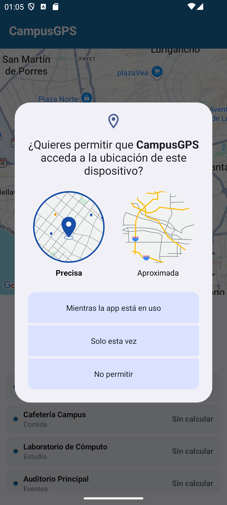
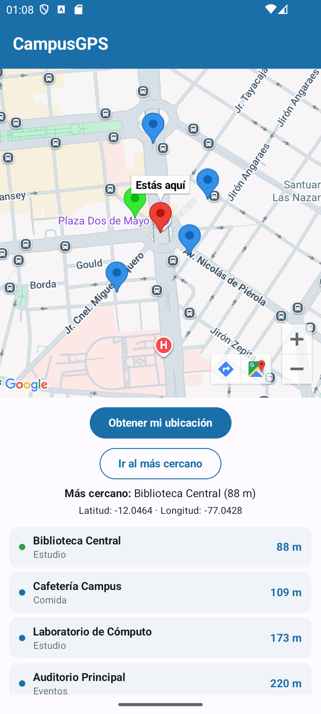
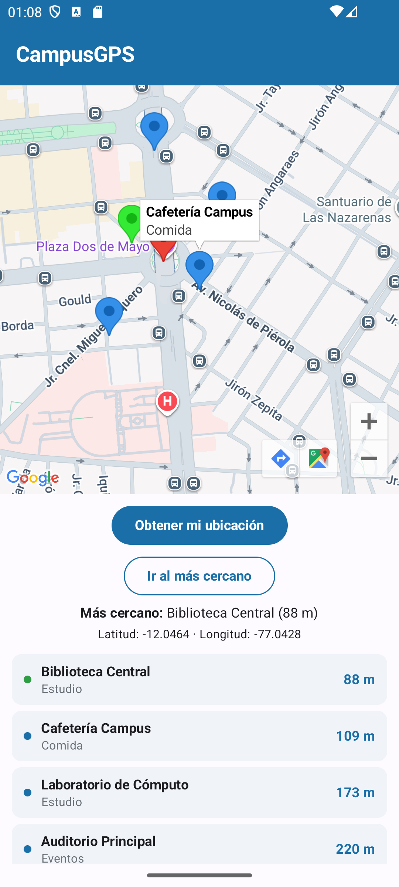
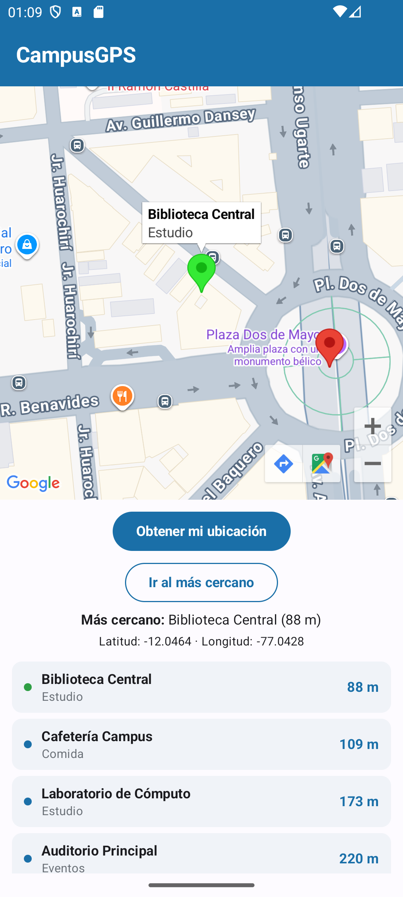
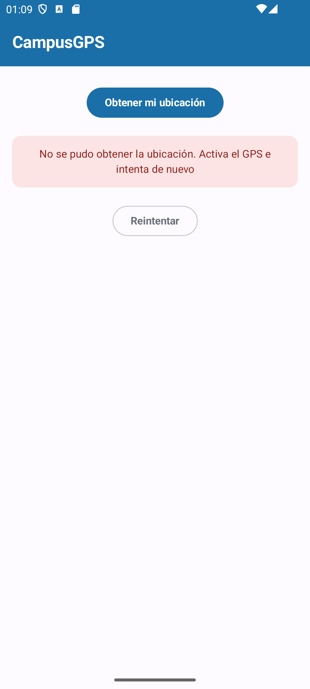

# CampusGPS

**Autor:** Jordan Alonso Abad Mejia
**Curso:** Programación en Móviles · Semana 13 · Localización Geográfica
**Docente:** Juan León S.

## Descripción

CampusGPS es una app Android que obtiene la ubicación del celular, la muestra en un mapa de Google y te dice qué lugar del campus tienes más cerca. Muestra cinco puntos ficticios (biblioteca, cafetería, laboratorio, auditorio y estacionamiento) con su distancia en metros, ordenados del más cercano al más lejano. El más cercano se marca en verde y se puede llegar a él con el botón **Ir al más cercano**.

La app sigue funcionando aunque el usuario niegue el permiso, apague el GPS o el dispositivo no tenga Google Play Services: en cada caso muestra un mensaje claro y una acción útil.

**Tecnología:** Kotlin, Jetpack Compose, Material 3 (sin XML), Google Play Services Location (`FusedLocationProviderClient`), Maps Compose.
**Patrón:** MVVM + Repository (interface).

## Cómo ejecutar

1. Clonar el repositorio y abrirlo en Android Studio.
2. Crear una clave de API en Google Cloud con **Maps SDK for Android** habilitado, restringida al paquete `com.tecsup.campusgps` y a la huella SHA-1 (`./gradlew signingReport`).
3. Agregar la clave en `local.properties` (este archivo no se sube al repositorio):
   ```
   MAPS_API_KEY=tu_clave
   ```
4. Ejecutar en un emulador con Google Play y ubicarlo en el punto base `-12.0464, -77.0428`.

## Estructura de paquetes

```
com.tecsup.campusgps/
├── MainActivity.kt
├── model/
│   └── Modelos.kt                    Posicion, Lugar, LugarConDistancia, TipoError, UbicacionUi
├── data/
│   ├── UbicacionRepository.kt        interface + UbicacionNoDisponibleException
│   ├── UbicacionRepositoryGoogle.kt  implementación con FusedLocationProviderClient
│   ├── LugaresRepository.kt          interface
│   └── LugaresRepositoryLocal.kt     los 5 lugares del campus
├── util/
│   ├── Distancia.kt                  distanciaMetros()
│   └── Formato.kt                    formatearDistancia()
├── viewmodel/
│   ├── MapaViewModel.kt
│   └── CampusViewModelFactory.kt
└── ui/
    ├── PantallaMapa.kt
    ├── MapaUbicacion.kt
    ├── ListaLugares.kt
    ├── MensajeError.kt
    └── theme/
```

## Arquitectura MVVM + Repository

```
View (PantallaMapa)
   | evento: pulsar el botón        ^ collectAsState()
   v                                | StateFlow
ViewModel (MapaViewModel) ----------+
   | llama a las interfaces
   v
UbicacionRepository ---> UbicacionRepositoryGoogle (FusedLocationProviderClient)
LugaresRepository   ---> LugaresRepositoryLocal (los 5 lugares fijos)
```

| Capa | Conoce a | No hace |
|---|---|---|
| View (`ui/`) | Solo a su ViewModel | No usa Repository, `FusedLocationProviderClient` ni calcula distancias |
| ViewModel | Solo a las interfaces de Repository | No conoce Composables ni recibe un `Context` |
| Repository | Google Play Services (en la implementación) | No expone clases de UI |
| `util/` | Funciones puras (distancia, formato) | No guarda estado |

## Capturas

| Permiso | Mapa con mi ubicación | Marcadores |
|---|---|---|
|  |  |  |

| Lista ordenada | Error |
|---|---|
|  |  |

## Pruebas de aceptación

| Prueba | Resultado esperado | OK |
|---|---|---|
| Abrir la app por primera vez y pulsar el botón | Aparece el cuadro de permiso | ✅ |
| Aceptar el permiso | Se ven latitud, longitud y el marcador Estás aquí | ✅ |
| Negar el permiso | Mensaje de error con Abrir ajustes, la app no se cierra | ✅ |
| Ubicación en el punto base | Los 5 marcadores azules aparecen cerca de tu posición | ✅ |
| Tocar un marcador | Se ve el nombre y la categoría del lugar | ✅ |
| Lista de lugares | Ordenada de menor a mayor distancia, con m o km | ✅ |
| Tocar una tarjeta de la lista | La cámara viaja a ese lugar y la tarjeta queda resaltada | ✅ |
| Ir al más cercano | La cámara va al lugar verde; el botón está deshabilitado antes de buscar | ✅ |
| Cambiar la ubicación del emulador y buscar otra vez | Las distancias, el orden y el lugar verde se actualizan | ✅ |
| Ubicación apagada | Mensaje de GPS con Reintentar | ✅ |
| Rotar la pantalla | No se pierden la ubicación ni la lista | ✅ |
| Revisar el repositorio | La clave no aparece en el código y `local.properties` no está subido | ✅ |

## Para pensar

**1. ¿Por qué `FusedLocationProviderClient` está dentro del Repository y no en el ViewModel?**
Porque es una fuente de datos de Android que necesita un `Context` para crearse. Si estuviera en el ViewModel, este dependería de Google Play Services y de un `Context`; como el ViewModel vive más que la Activity (sobrevive a la rotación), guardar un `Context` puede provocar fugas de memoria. Al dejarlo en `UbicacionRepositoryGoogle`, el ViewModel solo conoce la interface `UbicacionRepository`: no sabe de dónde sale la ubicación, se puede cambiar la implementación (por ejemplo, un repositorio falso para pruebas) sin tocar el ViewModel, y cada capa tiene una sola responsabilidad.

**2. ¿Qué diferencia hay entre el permiso de ubicación y la clave de API de Maps? ¿Qué pasa si falta cada uno?**
El permiso (`ACCESS_FINE_LOCATION` / `ACCESS_COARSE_LOCATION`) es la autorización que da el **usuario** para que la app lea la ubicación del dispositivo; se declara en el Manifest y se pide en tiempo de ejecución. La clave de API identifica a la **app ante Google** para poder usar el servicio de mapas (Maps SDK for Android). Son dos servicios distintos.
- Si falta el permiso, el mapa se sigue viendo, pero no se puede obtener la ubicación: la app muestra *"Sin permiso de ubicación no puedo mostrar dónde estás"* con el botón **Abrir ajustes**.
- Si falta la clave (o es incorrecta), la ubicación sí se obtiene, pero el mapa sale gris o en blanco y en Logcat aparece *Authorization failure*. Si no existe el `<meta-data>` de la clave en el Manifest, la app se cierra al abrir el mapa.

**3. ¿Por qué la clave va en `local.properties` y no en el código? ¿Qué harías si se subiera a GitHub por error?**
Porque `local.properties` está en `.gitignore` y nunca se sube al repositorio, mientras que el código sí se publica. Si la clave estuviera en el código, cualquiera podría copiarla y usarla con mi cuenta de Google Cloud. Gradle la lee de `local.properties` y la inyecta en el Manifest con `manifestPlaceholders["MAPS_API_KEY"]`.
Si se subiera por error: la borraría (o la rotaría) de inmediato en Google Cloud, crearía una clave nueva restringida a mi paquete y SHA-1, revisaría que `local.properties` esté en `.gitignore` y la eliminaría del historial de Git. La clave anterior ya no es segura aunque se borre del último commit, porque queda en el historial.

**4. ¿Dónde calculas la distancia y por qué no en el Composable?**
La distancia se calcula con la función pura `distanciaMetros()` de `util/Distancia.kt` (usa `Location.distanceBetween`), y la llama el ViewModel en `actualizarDistancias()`, solo dentro de `buscar()` cuando la ubicación llega con éxito. Ahí también se ordena la lista y se publica en un `StateFlow`. No se calcula en el Composable porque los Composables se recomponen muchas veces y repetirían el cálculo; además, mezclar lógica en la vista rompe MVVM, impide probar la lógica por separado y el resultado no sobreviviría a la rotación. La pantalla solo dibuja el estado que recibe.

**5. ¿Qué pasa con tu app si el usuario niega el permiso dos veces? ¿Cómo lo manejas?**
Después de negarlo dos veces, Android lo considera denegado de forma permanente y ya no muestra el cuadro: el launcher responde "negado" de inmediato. La app no se cierra: llama a `vm.permisoDenegado()`, que publica un `Error` de tipo `SIN_PERMISO`, y `MensajeError` muestra el mensaje con el botón **Abrir ajustes**. Ese botón abre la pantalla de la app en Ajustes con `Settings.ACTION_APPLICATION_DETAILS_SETTINGS` y `Uri.fromParts("package", packageName, null)`, para que el usuario conceda el permiso y vuelva a pulsar **Obtener mi ubicación**.
